ISDA Stfecient Markets

# ISDA CAPITAL CRIF: SA-CCR RISK DATA STANDARDS Version 1.7: 23 Oct 2023

# ISDA Sfficient Markets

# Contents

Track changes.. 3

1 Introduction 4   
2 Common Risk Interchange Format (CRIF) 4   
3 Format overview .. 4   
4 Fields description .   
Table 1: RiskType options for SA-CCR 7   
Table 2: HedgingSet options for SA-CCR ... . 8   
Table 3: Qualifier options for SA-CCR.. 9   
Table 4: Bucket options for SA-CCR.... .... 9   
Table 5: Label1 options for SA-CCR .... . 9   
Table 6: Label2 options for SA-CCR ..... .... 9   
Table 7: Amount options for SA-CCR... . 10   
Table 8: EndDate options for SA-CCR . .. 10   
Table 9: Other_Info options for SA-CCR. . 10

# ISDA Sfficient Markets

# Track changes

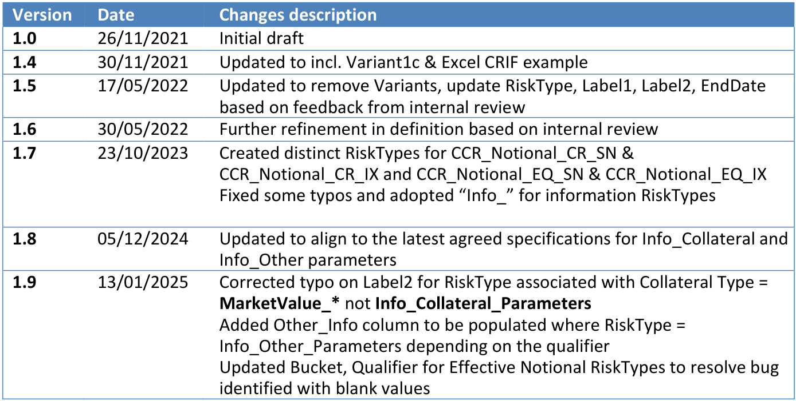

# ISDA Sfficient Markets

# 1 Introduction

The Capital Common Risk Interchange Format (Capital-CRIF) has been developed to support the ISDA industry wide benchmarking exercise that was initiated in 2018 and has been running across FRTB-SA, CVA, and SA-CCR1 standardised approaches to help measure and hopefully decrease the degree of variability in the implementation of these models. The process requires exchange of risk data for multiple benchmark portfolios, between participating institutions and ISDA. Therefore, a structured and standardised format to transmit such data was required.

This document proposes a common standard for describing SA-CCR counterparty portfolio data, including a complete specification of the data format required to support SA-CCR exposure calculations, as well as giving additional descriptions and clarifications of the various ways that this portfolio data can be represented within the CRIF.

# 2 Common Risk Interchange Format (CRIF)

It is clearly advantageous to proscribe a standardised way of describing portfolios, trades, and legal agreement data that are relevant to the computation of SA-CCR. It provides a common definition of a portfolio that is understood by all market participants. This is very helpful primarily for:

Market participants as part of the reconciliation process to resolve differences in calculated SACCR values.   
Third party vendors which aim to provide SA-CCR calculation product / services.   
ISDA member firms for implementation unit-testing, benchmarking and other validation processes.   
New (potentially smaller) firms in their implementation of the SA-CCR methodology.

The proposal is for a simple, robust format, which can be read by automated processes as well as being capable of manual inspection that covers the raw portfolio data inputs as well as transformed processed data into a SA-CCR calculation ready format.

# 3 Format overview

The format can be implemented as an Excel file or in any other column-based file extension like csv or txt, with defined data fields arranged in columns. Elements can be either textual (string), date or numerical and type can be context dependent.

The first row of the Excel file contains the header with the names of the columns.

SA-CCR is a counterparty portfolio calculation where the portfolio is described by transactions, legal agreements, and collateral positions under a specific counterparty. Each transaction or transaction set

# ISDA Sfficient Markets

and collateral positions contribute to the calculation of potential future exposure (PFE) and replacement cost (RC) components of SA-CCR exposure.

Therefore, each additional row in the CRIF contains a single entry that determines the component of the SA-CCR Exposure at Default (EAD) calculation, i.e., PFE or RC, at an individual trade or summary position level for a given portfolio.

Below we provide a quick overview of each column. For more details see $^ { \prime \prime } 5$ . Fields Description”.

The first seven keys describe the level at which the data is being submitted as well as describing the portfolio:

1. PortfolioID - string containing unique identifier for the collateral agreement or null if uncollateralised.   
2. TradeID - string containing unique transaction, transaction and transaction leg number, collateral position identifier.   
3. CounterpartyName – string containing name of the counterparty on the portfolio.   
4. CounterpartyID – string containing unique identifier for the counterparty on the portfolio.   
5. PartyName – string containing name of the party submitting the portfolio.   
6. PartyID – string containing unique identifier for the party submitting the portfolio.   
7. NettingSetNumber – string containing unique identifier for the master netting agreement, or null if non-netted.

There are eight fields that are used to describe the relevant SA-CCR attributes required to support calculation of PFE Addon and Replacement Cost components of the Exposure at Default (EAD):

8. RiskType – mandatory string describing the type of data o the notional type for each asset class of the trade / summary position o the mark to market (Present Value - PV) of the trade / summary position o the market value pre / post supervisory haircut for collateral positions o Info_Collateral_Parameters for collateral agreement static/reference data o Info_Other to describe SA-CCR relevant data fields not related to trade or collateral positions

9. HedgingSet –string field describing o the hedging set defined as per SA-CCR ruleset for each Asset Class

10. Qualifier – string field that contains

o the risk driver for transaction notional and transaction adjusted notional amount. Blank for transaction effective notional amount   
o the agreement direction (OneWayIn, OneWayOut, Mutual, STM) for collateral agreements   
$\bigcirc$ the collateral SubType for non-cash collateral positions   
o description of specific Info_Other parameter/data type being specified

11. Bucket – string fields that denotes

o the SubAsset Class or Maturity Bucket applicable to the transaction or summary position given the Asset Class   
o the termination currency of the agreement   
o the rating grade of bond collateral positions, main/other index for equity collateral positions

12. Label1 – additional qualifier that describes o the supervisory delta used for trade level notional amounts, blank at summary position level

# ISDA Sficient Markets

o whether specific Info_Other_Parameters are applicable in calculating SA-CCR EAD

13. Label2 – additional qualifier used to further specify the

o the supervisory duration used for trade level notional amounts for interest rate / credit trades, blank for other trades and blank at summary position level   
o the collateral position type for collateral positions

14. ValuationDate –the close of business date

15. EndDate – the maturity date for the transaction or bond collateral position. o YYYY-MM-DD” format

There are a further three columns to contain the amount associated with the RiskType and where relevant Qualifier:

16. Amount – numerical amount field populated with o the SA-CCR notional, adjusted notional or effective notional depending on RiskType o the mark to market (Present Value- PV) of the trade / summary position o the market value pre / post supervisory haircut for collateral positions o Threshold and Minimum Transfer Amount associated with the collateral agreement o Margin Period of Risk in business or calendar days o PFE Multiplier calculated for the margined and unmargined case

17. AmountCurrency – currency of the “Amount” field. Should be a standard three-letter ISO currency code where Amount is populated with

o the SA-CCR notional, adjusted notional or effective notional depending on RiskType o the mark to market (Present Value- PV) of the trade / summary position o the market value pre / post supervisory haircut for collateral positions o Threshold and Minimum Transfer Amount associated with the collateral agreement

And blank otherwise

18. AmountUSD – Amount expressed in USD where amount field is populated with o the SA-CCR notional, adjusted notional or effective notional depending on RiskType o the mark to market (Present Value- PV) of the trade / summary position o the market value pre / post supervisory haircut for collateral positions o Threshold and Minimum Transfer Amount associated with the collateral agreement

And blank otherwise

Plus, a further three columns which designate what model and rule standard is being considered.

19. Regulation – string field that describes which ruleset; Basel, CRR, UK_PRA, US_FR, etc., is being used to compute SA-CCR   
20. Model – string field populated with ‘SA-CCR’ to denote this Capital-CRIF contains SA-CCR relevant data as opposed to SA-CVA, FRTB-SA, etc.   
21. Other_Info – field is populated with portfolio, calculation properties that are relevant in the calculation of SA-CCR depending on the RiskType.

# ISDA Sfficient Markets

# 4 Fields description

Where dates are used in CRIF files, they should be formatted according to the ISO 8601 standard, which can be described as “YYYY-MM-DD”, so that 1 September 2016 would be $^ { \prime \prime } 2 0 1 6 \ – 0 9 – 0 1 ^ { \prime \prime }$ . This format is unambiguous and has useful sorting properties. Below we give a detailed description of the various fields:

RiskType: Mandatory string field   
Table 1: RiskType options for SA-CCR   
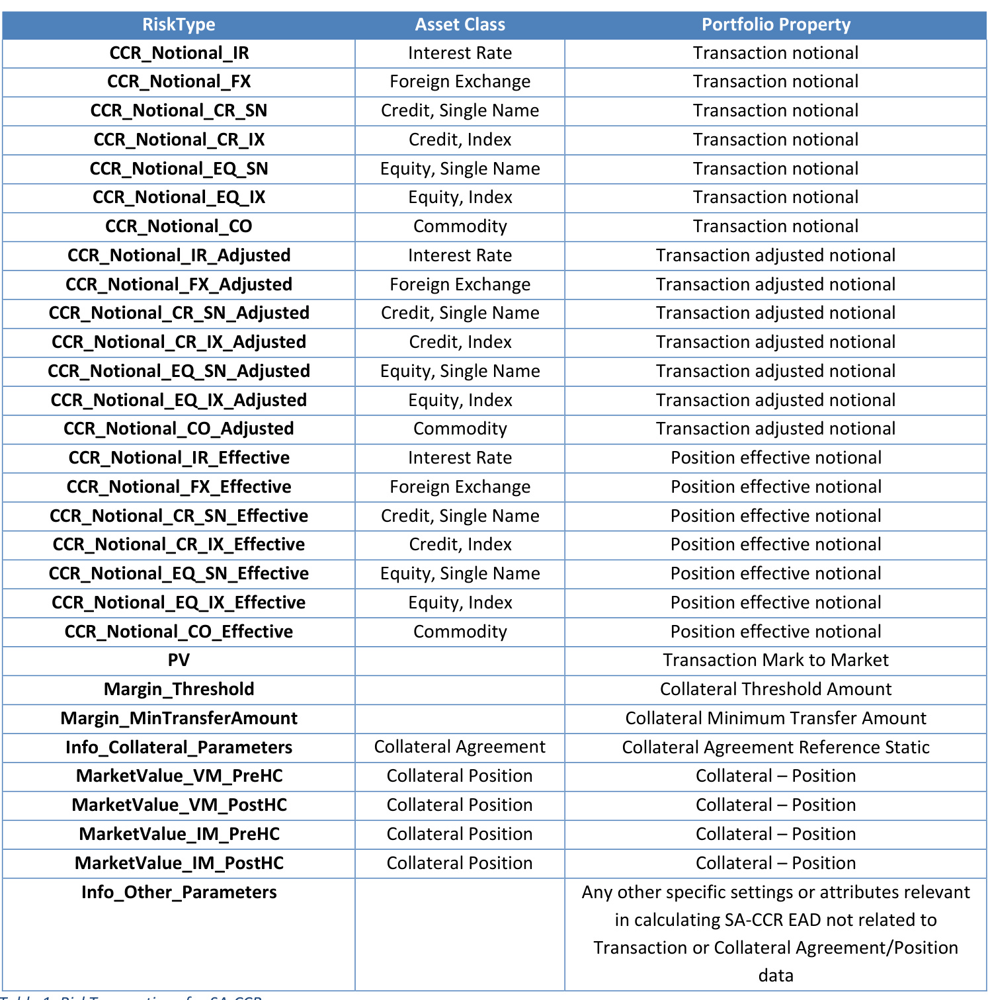

# ISDA Sfcient Markets

# HedgingSet: String field dependent upon RiskType field

Table 2: HedgingSet options for SA-CCR   
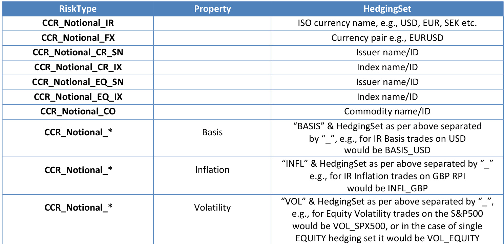

Qualifier: This field has different meanings depending on the RiskType

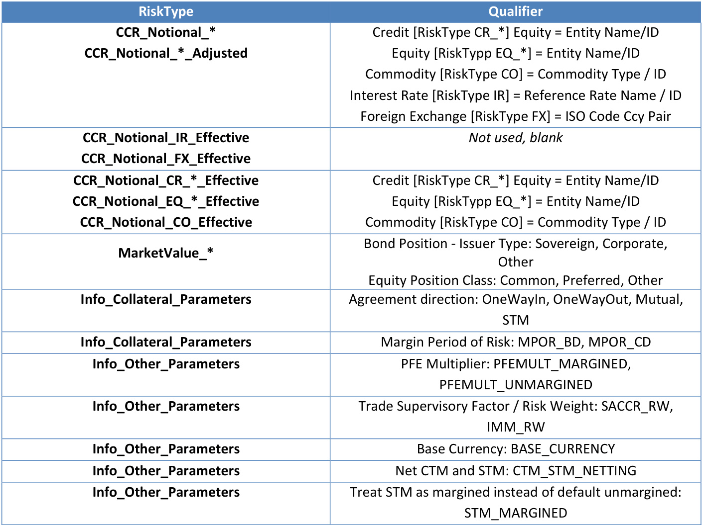

Table 3: Qualifier options for SA-CCR   
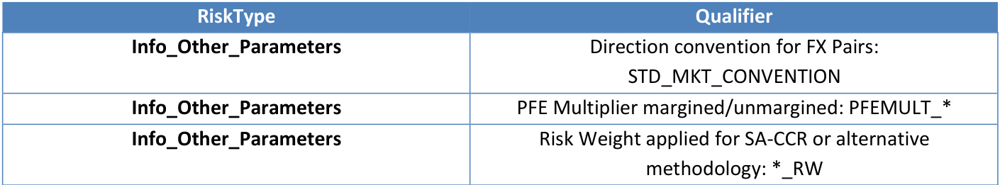

Bucket: This field has different meanings depending on the RiskType:   
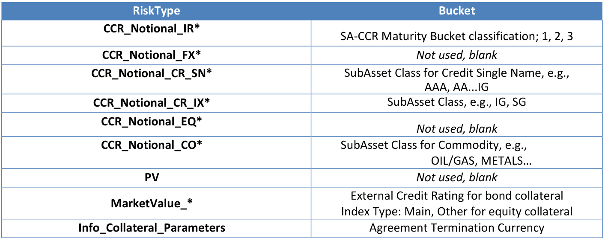

# Label1: This field has different meanings depending on the RiskType

Table 4: Bucket options for SA-CCR   
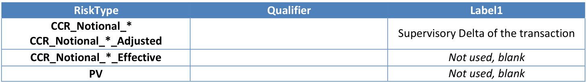
Table 5: Label1 options for SA-CCR

Label2: This field has different meanings depending on the RiskType   
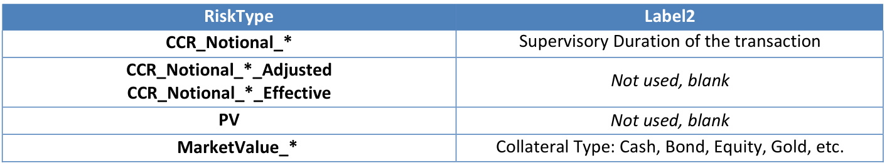
Table 6: Label2 options for SA-CCR

Amount: The amount field is populated with differing values depending on the RiskType and Qualifier

# ISDA Sfiecient Markets

EndDate: This field captures Maturity date for trades or bond collateral positions   
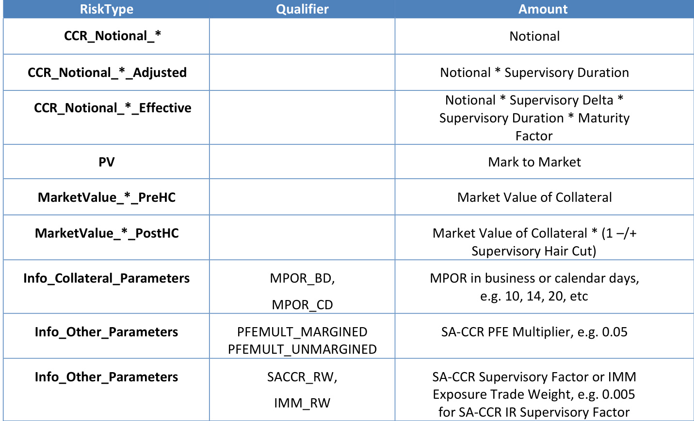
Table 7: Amount options for SA-CCR

Other_Info: The amount field is populated with differing values depending on the RiskType and Qualifier   
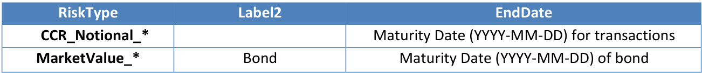
Table 8: EndDate options for SA-CCR

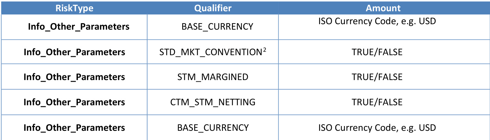
Table 9: Other_Info options for SA-CCR