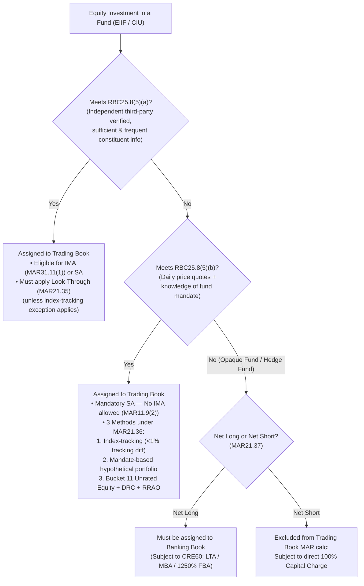

# FRTB SA — Look-Through Approach

> [!info] Regulatory Reference
> - **Basel Definition**: [[MAR_20260323.pdf#page=8|MAR10.8, page 8]]
> - **Boundary & Scope**: [[RBC25.pdf#page=3|RBC25.8(5), page 3]], [[MAR_20260323.pdf#page=13|MAR11.9, page 13]], [[MAR_20260323.pdf#page=99|MAR31.11, page 99]]
> - **SBM Indices & Multi-Underlying Options**: [[MAR_20260323.pdf#page=36|MAR21.31–21.34, 21.38, pages 36–39]] / [[CRR_20260101.pdf#page=480|CRR3 Art. 325i, page 480]]
> - **SBM Equity Investments in Funds (EIIFs / CIUs)**: [[MAR_20260323.pdf#page=38|MAR21.35–21.37, pages 38–39]] / [[CRR_20260101.pdf#page=482|CRR3 Art. 325j, page 482]]
> - **DRC & RRAO**: [[MAR_20260323.pdf#page=67|MAR22.5, 22.8, pages 67–68]], [[MAR_20260323.pdf#page=77|MAR22.39, page 77]], [[MAR_20260323.pdf#page=82|MAR23.6(5), page 82]]
> - **CVA Framework**: [[MAR_20260323.pdf#page=159|MAR50.49–50.50, 50.64, pages 159–162]]

---

## 1. Definition & Core Principle

Under **MAR10.8** ([[raw/MAR_20260323]]), the **Look-Through Approach (LTA)** is defined as:

> *"An approach in which a bank determines the relevant capital requirements for a position that has underlyings (such as an index instrument, multi-underlying option, or an equity investment in a fund) **as if the underlying positions were held directly by the bank**."*

### Key Mechanics
1. **Direct Holding Equivalence**: Instead of treating a fund, ETF, index, or basket option as a single opaque risk factor, the bank decomposes it into its constituent assets.
2. **Proportional Share & Leverage**: For equity investments in funds (EIIFs / CIUs), the decomposed exposures must scale for:
   - The bank's **proportional share** of the equity of the fund; and
   - Any **leverage** embedded in the fund structure ([[MAR_20260323.pdf#page=38|MAR21.35, page 38]]).
3. **Unrestricted Single-Name Netting**: Where look-through is applied to index instruments, multi-underlying options (excluding CTP), or funds, constituent sensitivities are allowed to **net without restriction** against sensitivities from directly held single-name instruments referencing the same issuer/risk factor ([[MAR_20260323.pdf#page=37|MAR21.34(1), page 37]] / [[CRR_20260101.pdf#page=480|CRR3 Art. 325i(1)(b)]]).
4. **Delta–Curvature Consistency**: For any given instrument, sensitivity inputs used for **delta** and **curvature** risk calculations must be consistent regardless of whether look-through is adopted ([[MAR_20260323.pdf#page=37|MAR21.32, page 37]]).

---

## 2. Which Risk Classes Apply?

> [!important] Crucial Distinction: Decomposed Constituents vs. "No Look-Through" Index Buckets vs. Fund Fallbacks
> Whether look-through applies to **all seven risk classes** or **specific risk classes** depends on which branch of the MAR hierarchy a position falls into ([[raw/Basel MAR Look-Through Approach Resources]]).

| Treatment Branch | Applicable Component & Risk Classes | Regulatory Reference |
|---|---|---|
| **1. Full Look-Through Applied** (Funds, bespoke indices, non-qualifying indices, or voluntary index look-through) | **All 7 SBM Risk Classes** + **DRC** + **RRAO** (depending on what underlying assets the fund/index holds): • [[FRTB SA — GIRR\|GIRR]] (rates, bond curves, fund cash/derivatives) • [[FRTB SA — CSR Non-Securitisation\|CSR Non-Securitisation]] (corporate/sovereign debt, CDS) • [[FRTB SA — CSR Securitisation\|CSR Securitisation (non-CTP)]] • [[FRTB SA — CSR CTP\|CSR Securitisation (CTP)]] *(Note: Index CTP itself cannot be broken down — MAR21.34(2))* • [[FRTB SA — Equity Risk\|Equity Risk]] (constituent stocks) • [[FRTB SA — Commodity Risk\|Commodity Risk]] (constituent commodities) • [[FRTB SA — FX Risk\|FX Risk]] (currency mismatch between underlying assets and reporting currency) • [[FRTB SA — Default Risk Charge\|DRC]] (constituent issuer JTDs under MAR22.5) | MAR10.8, MAR21.31, MAR21.34, MAR21.35, MAR22.5 |
| **2. "No Look-Through" Opt-Out** (Qualified listed indices & index-tracking funds with tracking difference $< 1\%$) | **Only 2 SBM Risk Classes** (plus DRC look-through under MAR22.5): 1. **[[FRTB SA — Equity Risk\|Equity Risk]]** → Sector Buckets 1–11 (if $> 75\%$ in one sector) or **Index Buckets 12 & 13** 2. **[[FRTB SA — CSR Non-Securitisation\|CSR Non-Securitisation]]** → Sector Buckets 1–16 (if $> 75\%$ in one sector) or **Index Buckets 17 & 18** | MAR21.31, MAR21.33, MAR21.35(2), MAR21.38 |
| **3. Non-Look-Through Fund: Mandate-Based (Hypothetical Portfolio)** | **All SBM Risk Classes permitted by the fund's mandate** (standalone worst-case portfolio), plus **DRC**, **RRAO**, and simplified **CCR/CVA** (CRE60.7(c)). | MAR21.36(2), CRR3 Art. 325j(1)(b)(ii) & (4) |
| **4. Non-Look-Through Fund: "Other Sector" Equity Fallback** | • **SBM**: **[[FRTB SA — Equity Risk\|Equity Risk]] — Bucket 11 ("Other sector")** ($\text{RW} = 70\%$, zero correlation) • **DRC**: **Unrated Equity** ($\text{LGD} = 100\%$, $\text{RW} = 15\%$) or **Mandate-Based Max HY/Defaulted RW** (up to $100\%$) • **RRAO**: **Mandate-Based Max Exotic ($1.0\%$) / Other Residual ($0.1\%$)** | MAR21.36(3), MAR22.8, MAR23.6(5), CRR3 Art. 325j(1)(b)(i) |
| **5. SA-CVA / BA-CVA Index Treatment** | **3 CVA Risk Classes** support the optional Qualified Index bucket vs. mandatory look-through: • Counterparty Credit Spread Risk • Reference Credit Spread Risk • Equity Risk | MAR50.49–50.50, MAR50.64 |

---

## 3. Trading Book Eligibility Gate for Funds ([[Basel RBC25|RBC25.8(5)]])

Before applying MAR21, a bank must determine whether an **equity investment in a fund (EIIF)** is even eligible for the **trading book** ([[RBC25.pdf#page=3|RBC25.8(5), page 3]]):

---

## 4. Index Instruments & Multi-Underlying Options (MAR21.31–21.34, 21.38)

### 4.1 Default Rule vs. Qualified Index Opt-Out (MAR21.31)
For **delta** and **curvature** risk, the **Look-Through Approach is the default**. However, a bank may **opt not to apply look-through** for instruments referencing a **listed and widely recognised and accepted equity or credit index** that satisfies **all five conditions** ([[MAR_20260323.pdf#page=36|MAR21.31, page 36]] / [[CRR_20260101.pdf#page=480|CRR3 Art. 325i(3)]]):

| # | Criterion | Basel MAR21.31 | EU CRR3 Art. 325i(3) |
|---|---|---|---|
| 1 | **Transparency** | Possible to look through (constituents and weightings are known) | Same |
| 2 | **Diversification (Count)** | At least **20 constituents** | At least **20 constituents** |
| 3 | **Single-Name Concentration** | No single constituent represents $> 25\%$ of the total index | Same ($> 25\%$ of total market cap) |
| 4 | **Top-Decile Concentration** | Largest $10\%$ of constituents represents $< 60\%$ of the total index | Same (rounded up to next integer, $\le 60\%$) |
| 5 | **Market Capitalisation** | Total market cap of all constituents $\ge \text{USD } 40\text{ billion}$ | Total market cap $\ge \text{EUR } 40\text{ billion}$ |

> [!warning] Mandatory Look-Through Cases (MAR21.34)
> Look-through **must always be used** for:
> - Indices that fail any condition in MAR21.31(2)–(5);
> - Any multi-underlying instrument referencing a **bespoke basket** of equities or credit positions;
> - Once a bank adopts look-through for a specific instrument type referencing a particular index, it must apply it **consistently through time** and requires **supervisory approval** to revert to a "no look-through" approach (MAR21.34(3), Footnote 10).

### 4.2 Bucket Mapping When Opting Out of Look-Through (MAR21.33)
When a bank opts **not** to look through a qualified equity or credit index, it computes a **single sensitivity** to the index and assigns it as follows ([[MAR_20260323.pdf#page=37|MAR21.33, page 37]]):

1. **$> 75\%$ Single-Sector Rule**: If more than $75\%$ of the index's weighted constituents belong to a single specific sector bucket (Equity Buckets 1–11 or CSR Non-Sec Buckets 1–16), the entire index sensitivity is mapped to **that single sector bucket** and treated like a single-name sensitivity.
2. **Diversified Index Rule ($\le 75\%$ in any single sector)**: Mapped to dedicated **Index Buckets**:
   - **[[FRTB SA — Equity Risk|Equity Risk]]**:
     - **Bucket 12** ($\text{RW} = 15\%$): Large market cap and advanced economy indices (if $\ge 75\%$ of weighted constituents are both large cap and advanced economy).
     - **Bucket 13** ($\text{RW} = 25\%$): Other equity indices.
   - **[[FRTB SA — CSR Non-Securitisation|CSR Non-Securitisation]]**:
     - **Bucket 17** ($\text{RW} = 1.5\%$): Investment grade (IG) credit indices (if $\ge 75\%$ of weighted constituents are IG).
     - **Bucket 18** ($\text{RW} = 5.0\%$): High yield (HY) credit indices.

### 4.3 Special Rule for Index CTP (MAR21.34(2) & FAQ1)
- **No Decomposition Allowed**: An index in the **[[FRTB SA — CSR CTP|Correlation Trading Portfolio (CTP)]]** **cannot be broken down into its constituents** — it must be treated as a single risk factor as a whole, and single-name issuer netting does not apply.
- **Bucket Assignment**: Since CSR CTP uses Buckets 1–16 (without index buckets 17 and 18), an index CTP sensitivity is assigned to the specific sector bucket representing $\ge 75\%$ of its weighted constituents, or to **Bucket 16 ("Other sector")** if no single sector reaches $75\%$ (MAR21.34 FAQ1).

### 4.4 Vega Risk for Multi-Underlying Instruments (MAR21.38)
- In the **vega risk** context, multi-underlying options (including index options) are typically priced off the **implied volatility of the option itself** rather than constituent volatilities.
- Therefore, **a look-through approach is not required for vega risk**, regardless of whether look-through was applied for delta and curvature ([[MAR_20260323.pdf#page=39|MAR21.38(1), page 39]]). Index vega sensitivities are mapped using the same $> 75\%$ sector vs. index bucket rule (MAR21.38(2)).

---

## 5. Equity Investments in Funds (MAR21.35–21.37)

### 5.1 Funds With Look-Through Possibility (MAR21.35)
For funds meeting **RBC25.8(5)(a)**, banks **must apply the look-through approach** and treat the underlying positions of the fund as if held directly (scaling for proportional share and leverage), **except** in two specific cases:
1. **Fund Holding Qualified Index Instruments (MAR21.35(1))**: The bank looks through the fund to its holdings, and for any underlying index instrument held by the fund that meets MAR21.31, the bank may apply the "no look-through" index treatment (MAR21.33) to that index holding.
2. **Index-Tracking Funds / ETFs (MAR21.35(2))**: A bank may opt not to look through a fund that tracks an index benchmark and instead treat the fund as a direct position in the tracked index, provided:
   - The fund has an **absolute tracking difference** (ignoring fees and commissions) of **$< 1\%$**; and
   - The tracking difference (annualised return difference over the last 12 months of available data) is **checked at least annually**.

> [!note] MAR21.31 FAQ1 — Diversified Active Funds Cannot Use Index Buckets Directly
> Even if an actively managed fund happens to have $\ge 20$ constituents, $< 25\%$ max weight, and $\ge \text{USD } 40\text{bn}$ market cap, it **cannot** use the no-look-through index buckets unless it tracks a listed, widely recognised index and meets the $< 1\%$ tracking difference test in MAR21.35(2).

### 5.2 Funds Without Look-Through, But With Daily Prices & Mandate (MAR21.36)
For funds that do **not** meet RBC25.8(5)(a) but meet **RBC25.8(5)(b)** (daily price quotes + knowledge of the fund's mandate), the bank must use the Standardised Approach (MAR11.9(2)) and calculate capital in **one of three ways**:

| Method | Description & Requirements | Risk Class & Capital Impact |
|---|---|---|
| **Method 1: Index-Tracking** (`MAR21.36(1)`) | If the fund tracks a listed index benchmark and meets the $< 1\%$ tracking difference criteria in MAR21.35(2). | Treated as a position in the tracked index → mapped to **Equity (Buckets 1–13)** or **CSR Non-Sec (Buckets 1–18)** per MAR21.33. |
| **Method 2: Mandate-Based / Hypothetical Portfolio** (`MAR21.36(2)`) | **Subject to supervisory approval**, construct a hypothetical portfolio assuming the fund invests to the **maximum extent allowed under its mandate** in those assets attracting the **highest capital requirements** under SBM (and progressively in lower-capital assets). If multiple risk weights apply, the **maximum risk weight** must be used. | • Calculated on a **stand-alone basis** (no netting/diversification with other bank positions). • Covers all SBM risk classes permitted by the mandate. • Derivatives CCR and CVA risks must be calculated using the simplified banking book fund methodology under **CRE60.7(c)**. |
| **Method 3: Unrated "Other Sector" Equity (Fallback)** (`MAR21.36(3)`) | Treat the fund as a single unrated equity exposure allocated to **Equity Risk Bucket 11 ("Other sector")**. | • **SBM**: Equity **Bucket 11** ($\text{Delta RW} = 70\%$, no intra/inter-bucket correlation recognition). • **DRC (MAR22.8)**: Treated as unrated equity ($\text{LGD} = 100\%$, $\text{RW} = 15\%$), **or** if mandate allows high-yield/distressed debt, apply the **maximum achievable effective average RW** under the mandate (investing first in Defaulted $100\% \to \text{CCC } 50\% \to \text{B } 30\% \to \text{BB } 15\%$), with **no offsetting or diversification**. • **RRAO (MAR23.6(5))**: Assume the fund is exposed to **exotic underlyings ($1.0\%$)** and **other residual risks ($0.1\%$)** to the **maximum extent allowed under the mandate**. |

---

## 6. Look-Through in DRC, RRAO, IMA & CVA

### 6.1 Default Risk Charge ([[FRTB SA — Default Risk Charge|MAR22]])
- **Non-Securitisation Derivatives (MAR22.5)**: For traded non-securitisation credit and equity derivatives (e.g., index CDS, equity index futures/options), **JTD risk positions must be determined by applying a look-through approach** to each individual constituent issuer legal entity.
  - *JTD Equivalent Decomposition (MAR22.5 FAQ1)*: The JTD equivalent for a multi-underlying instrument is the difference between the instrument's value assuming each single name defaults separately (with zero recovery) and its value assuming no names default.
- **Securitisation Decomposition (MAR22.39(2)–(3))**: For CTP and non-CTP index tranches, offsetting by decomposition using a valuation model is permitted for vanilla securitisations (e.g., vanilla CDOs, index tranches) where decomposed single-name equivalents sum consistently to the undecomposed value, but is **prohibited for exotic securitisations** (e.g., $\text{CDO}^2$).
- **Bucket 11 Funds (MAR22.8 & FAQ1)**: Always assigned $\text{LGD} = 100\%$ for JTD calculation, with mandate-based worst-case rating RW if the mandate permits high-yield or distressed investments.

### 6.2 Residual Risk Add-On ([[FRTB SA — Residual Risk Add-On|MAR23]])
- **Index Instruments (MAR23.6(3) & (5))**: Multi-underlying European or American plain vanilla options (including index options) are **exempt** from the $0.1\%$ correlation residual risk add-on.
- **Bucket 11 Funds (MAR23.6(5))**: Must assume maximum mandate exposure to exotic underlyings ($1.0\%$) and other residual risks ($0.1\%$).

### 6.3 Internal Models Approach (MAR31.11)
- **IMA Eligibility Only for Look-Through Funds**: Under **MAR31.11(1)**, only funds meeting **RBC25.8(5)(a)** (full look-through) may be included in an IMA trading desk; their underlying positions and associated hedges are treated as directly held by that desk.
- Funds meeting only **RBC25.8(5)(b)** (daily prices + mandate, no look-through) **must be capitalised under the Standardised Approach** (MAR11.9(2), MAR31.11(2)).

### 6.4 Credit Valuation Adjustment (MAR50.49–50.50, 50.64)
- Under **SA-CVA**, hedging instruments that are indices generally require look-through sensitivity calculation across all constituents (MAR50.49).
- However, under **MAR50.50**, for **Counterparty Credit Spread Risk**, **Reference Credit Spread Risk**, and **Equity Risk**, a bank may opt to introduce dedicated risk factors for **qualified credit and equity indices** (those meeting MAR21.31), replacing constituent look-through with a single index sensitivity (e.g., mapped to Bucket 8 in CSR under MAR50.64, or using the $> 75\%$ sector rule). Non-qualified indices assigned to Buckets 1–7 must always be looked through.

---

## 7. Basel MAR vs. EU CRR3 Comparison (Articles 325i & 325j)

| Feature | Basel Framework (MAR21.31–21.38) | EU CRR3 (Articles 325i & 325j) |
|---|---|---|
| **Index Market Cap Threshold** | $\ge \text{USD } 40\text{ billion}$ (MAR21.31(5)) | $\ge \text{EUR } 40\text{ billion}$ (Art. 325i(3)(e)) |
| **Look-Through Frequency for CIUs** | "Sufficient and frequent information" verified by an independent third party (RBC25.8(5)(a)) | Explicitly specifies **at least monthly** look-through for trading book CIUs (Art. 325j(1)(a)) |
| **Third-Party Calculation Reliance** | Requires independent third-party verification of composition | **Art. 325j(6)** explicitly allows relying on the CIU depository, CIU management company, or audited third-party vendor to provide data/risk metrics |
| **Mandate-Based Approach (Hypothetical Portfolio)** | Requires supervisory approval; standalone calculation; CCR/CVA via CRE60.7(c) (MAR21.36(2)) | **Art. 325j(4) & (7)**: Same hypothetical portfolio is used across SBM, DRC, and RRAO; EBA mandated to submit draft RTS on hypothetical portfolio methodology & maximum leverage by **10 January 2027** |

---

## 8. External Web Resources

From [[raw/Basel MAR Look-Through Approach Resources]]:
- [BIS Basel Framework — MAR10 (Definitions: MAR10.8 Look-Through Approach)](https://www.bis.org/basel_framework/chapter/MAR/10.htm?inforce=20230101&published=20200327)
- [BIS Basel Framework — MAR21 (Sensitivities-Based Method: MAR21.31–21.38)](https://www.bis.org/basel_framework/chapter/MAR/21.htm?inforce=20230101&published=20240705)
- [BIS Basel Framework — MAR22 (Default Risk Capital Requirement: MAR22.5, MAR22.8)](https://www.bis.org/basel_framework/chapter/MAR/22.htm?inforce=20230101&published=20200327)
- [EBA Interactive Single Rulebook — CRR Article 325i](https://www.eba.europa.eu/regulation-and-policy/single-rulebook/interactive-single-rulebook/12191)
- [EUR-Lex — Regulation (EU) 2024/1623 (CRR3 Full Text)](https://eur-lex.europa.eu/legal-content/EN/TXT/?uri=OJ:L_202401623)
- [Decode Finance — FRTB MAR21 Series: SBM Mechanics & Look-Through](https://decode-finance.com/frtb-mar21-series8d-sbm-mechanics-look-through/)
- [ISDA & IIF — Response to EC Consultation on the Market Risk Prudential Framework](https://www.isda.org/a/vgfgE/ISDA-IIF-Response-to-ECs-Consultation-on-the-Market-Risk-Prudential-Framework.pdf)
- [KPMG — Basel 4 Publications: FRTB SA & CIU Treatment](https://assets.kpmg.com/content/dam/kpmgsites/xx/pdf/2022/08/basel-4-publications.pdf.coredownload.inline.pdf)

---

## See Also

- [[FRTB SA — Sensitivities-Based Method]]
- [[FRTB SA — Equity Risk]]
- [[FRTB SA — CSR Non-Securitisation]]
- [[FRTB SA — CSR CTP]]
- [[FRTB SA — Default Risk Charge]]
- [[FRTB SA — Residual Risk Add-On]]
- [[Basel RBC25]]
- [[CRR3 Article Map]]
- [[FRTB SA — Basel vs CRR3 Comparison]]

